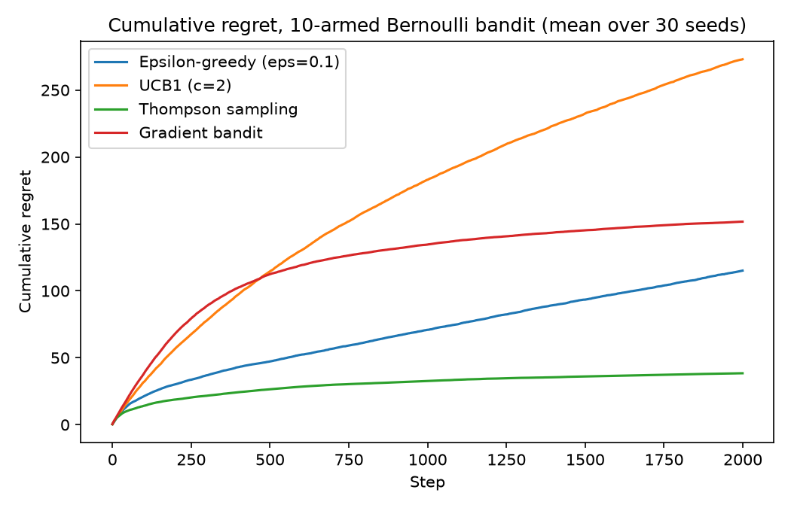
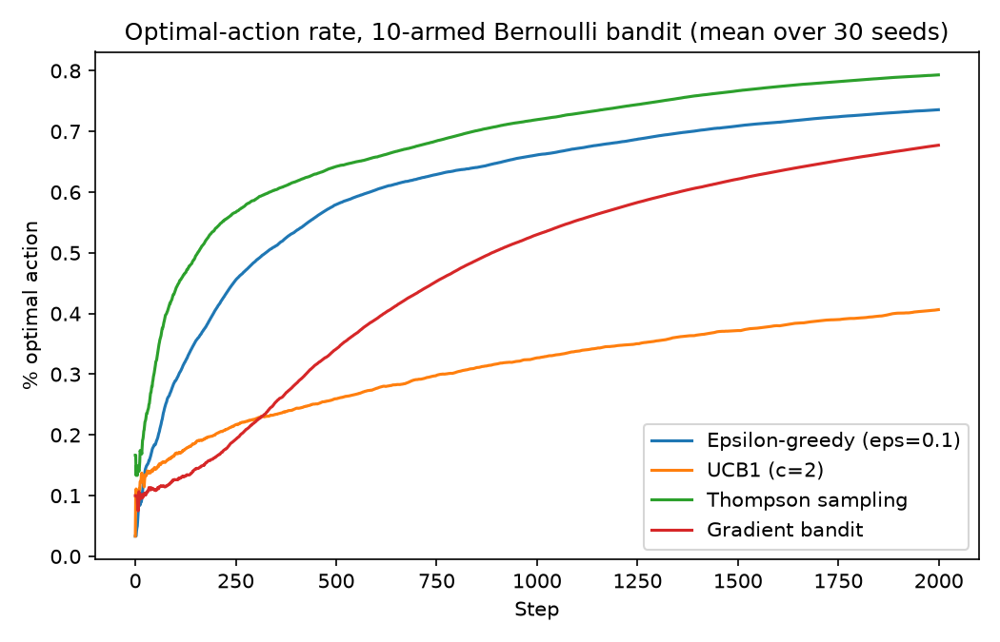
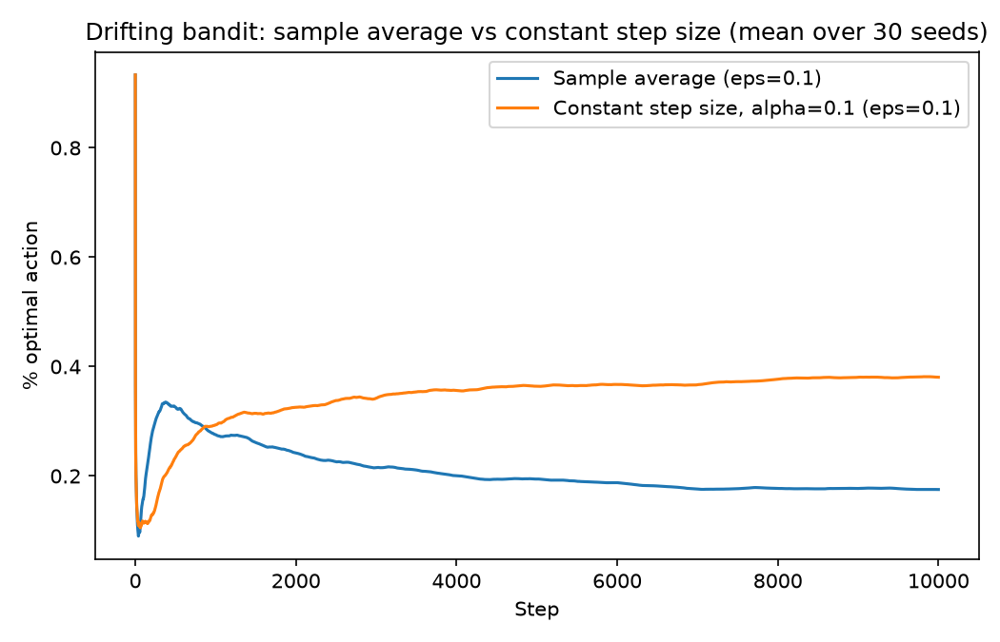

# bandit-exploration-lab

Multi-armed bandit exploration algorithms, implemented from scratch in
numpy and compared empirically rather than by citation alone: epsilon-greedy,
UCB1, Thompson sampling, and the gradient bandit algorithm, plus a
non-stationary ("restless") bandit used to test whether each algorithm's
value estimates can actually track a moving target.

This sits one level below [social-dilemma-rl](https://github.com/ZahraAliAlharz/social-dilemma-rl)
in the RL stack: a single-state, single-agent exploration-exploitation
problem, versus the multi-state, multi-agent social dilemmas there. Same
question underneath both — how does an agent that only sees its own
reward decide what to do? — asked at two different levels of complexity.

## Install

```bash
pip install -e ".[dev]"
pytest -q
```

## Algorithms

- **Epsilon-greedy** — acts greedily with respect to action-value estimates
  `Q(a)`, except with probability `epsilon` it picks a uniformly random arm.
  Supports both the unweighted sample-average update and a constant step
  size, which matters for the non-stationary experiment below.
- **UCB1** (Auer, Cesa-Bianchi & Fischer, 2002) — picks the arm maximizing
  `Q(a) + c * sqrt(ln(t) / N(a))`, an optimism bonus that shrinks as an arm
  is tried more and grows (slowly) with total time, giving a principled
  exploration schedule instead of a fixed random-exploration rate.
- **Thompson sampling** — Bayesian: maintains a Beta posterior over each
  arm's success probability, samples one value per arm each step, and
  plays whichever arm's sample is highest. Naturally shifts from
  exploration to exploitation as posteriors concentrate.
- **Gradient bandit** (Sutton & Barto, 2018, §2.8) — maintains a softmax
  action-preference vector updated by stochastic gradient ascent on
  expected reward, using a running average reward as a baseline to reduce
  update variance.

## Results

### 1. Thompson sampling has the lowest regret on a stationary problem

10-armed Bernoulli bandit, 2000 steps, 30 random problem instances:




| Agent | Final cumulative regret (mean ± std, 30 seeds) |
|---|---|
| Thompson sampling | 38.4 ± 28.5 |
| Epsilon-greedy (eps=0.1) | 115.1 ± 35.8 |
| Gradient bandit | 151.7 ± 30.8 |
| UCB1 (c=2) | 273.0 ± 40.5 |

Thompson sampling comes out clearly ahead: its posterior uncertainty
collapses quickly on a 10-armed problem, so it stops paying for exploration
much sooner than the others. UCB1 with the textbook exploration constant
`c=2` is the worst performer here — not because the algorithm is wrong, but
because `c=2` is tuned for a worst-case regret bound, not for this specific
10-armed, 2000-step regime, and it keeps probing underperforming arms far
longer than the problem actually calls for. That's a real, reproducible
finding about this specific setup, not a property of UCB1 in general — it's
also the kind of thing a regret bound hides and an actual run exposes.

### 2. Constant step size tracks a moving target; sample averages get stuck

Epsilon-greedy on a drifting 10-armed Bernoulli bandit (every arm's success
probability takes a small Gaussian random-walk step after every pull),
10,000 steps, 30 seeds — reproducing Sutton & Barto (2018), exercise 2.5:



| Agent | Final optimal-action rate (mean ± std, 30 seeds) |
|---|---|
| Constant step size, alpha=0.1 | 0.381 ± 0.049 |
| Sample average | 0.175 ± 0.039 |

The sample-average update weights every reward equally over the agent's
entire history, so its effective step size (`1/N(a)`) shrinks toward zero
exactly as the environment keeps changing — it learns a value estimate for
an arm that no longer describes where that arm's true probability drifted
to. A constant step size keeps weighting recent rewards more heavily no
matter how long the agent has run, so it can keep re-estimating a moving
target. More than double the optimal-action rate here isn't a close call —
in a non-stationary setting, the "statistically correct" sample average is
the wrong tool.

## Repository layout

```
src/bandit_lab/
  envs/bandits.py        # BernoulliBandit, GaussianBandit, DriftingBernoulliBandit
  agents/epsilon_greedy.py
  agents/ucb.py
  agents/thompson.py
  agents/gradient.py
  metrics.py               # run_bandit(): regret + optimal-action-rate tracking
  train.py                 # single-run CLI
experiments/
  sweep_stationary.py      # generates results/stationary_*.png
  sweep_nonstationary.py   # generates results/nonstationary_comparison.png
tests/                      # pytest suite for envs, agents, metrics
```

## Usage

```bash
# Single run from the CLI
python -m bandit_lab.train thompson --k 10 --steps 2000

# Full sweeps that regenerate the figures above
python experiments/sweep_stationary.py
python experiments/sweep_nonstationary.py
```

## What I'd do next

- Add a contextual-bandit variant (linear UCB / LinTS) where the reward
  distribution depends on observed side information, bridging toward
  full RL with state.
- Try UCB1-Tuned or a KL-UCB variant and see whether it closes the gap with
  Thompson sampling without losing UCB's distribution-free guarantees.
- Sweep the drift rate in the non-stationary experiment rather than fixing
  it at one value, to find where constant-step-size's advantage actually
  starts and how it scales.

## References

- Auer, P., Cesa-Bianchi, N., & Fischer, P. (2002). Finite-time Analysis of
  the Multiarmed Bandit Problem. *Machine Learning*.
- Sutton, R. S., & Barto, A. G. (2018). *Reinforcement Learning: An
  Introduction* (2nd ed.), Chapter 2.

## License

MIT — see [LICENSE](LICENSE).
